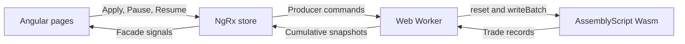

# Market Stream Dashboard

An Angular dashboard for simulated trades and quotes. A seeded AssemblyScript WebAssembly module generates market updates inside a Web Worker, and the dashboard shows cumulative metrics for the active run.

[Live demo](https://market-stream-dashboard.vercel.app) · [GitHub repository](https://github.com/aleksandr-borovoi-dev/market-stream-dashboard) · [Original assignment](docs/Senior%20Frontend%20Developer%20Task.docx)

## Try the demo

1. Open the table and watch trades update the price, spread, volume, VWAP, and order-book imbalance for each instrument. [Market](https://market-stream-dashboard.vercel.app/market)
2. Select **Pause**, visit **Settings**, and return to **Market**. The table stays paused with the same totals. Select **Resume** to continue the run.
3. Pause again, edit the settings, and select **Apply**. A fresh run starts with the new settings and empty totals. [Producer settings](https://market-stream-dashboard.vercel.app/setup)

| Setting           | Default | Allowed range |
| ----------------- | ------: | ------------- |
| Instrument count  |       5 | 1–50          |
| Updates per batch |     100 | 1–1,000       |
| Batch interval    |  500 ms | 50–2,000 ms   |

The nominal rate is `updatesPerBatch * 1000 / intervalMs` across all instruments. The defaults request 200 updates per second.

## Run locally

Use Node.js 24.15.0 and npm 11.12.1. The Node version is recorded in `.nvmrc`.

```sh
git clone https://github.com/aleksandr-borovoi-dev/market-stream-dashboard.git
cd market-stream-dashboard
npm ci
npm start
```

The development server listens on port 4200. [Local dashboard](http://127.0.0.1:4200)

## Checks and build

```sh
npm run check          # Formatting, lint, TypeScript, unit tests and production build
npm run verify         # Lint, TypeScript, unit tests and production build
npm test               # Compile and test Wasm, then run TypeScript unit tests
npm run test:wasm      # Compile and test the real Wasm module
npm run test:watch     # Watch TypeScript unit tests
npm run lint
npm run typecheck
npm run format:check
npm run format        # Apply formatting
npm run build
npm run build:wasm     # Compile assembly/producer.ts to public/market-stream.wasm
```

Vitest covers settings validation, the assignment's worked metric example, unavailable values, instrument isolation, large integer totals, and rounding. Worker tests use controlled clocks and loads to verify scheduling, run replacement, failure handling, cleanup, and memory decoding. Integration tests exercise the real Angular routes, Signal Forms, and NgRx with a controlled Worker channel. They verify navigation during a paused run and late replies after overlapping Apply submissions. [Application integration tests](src/app/app.integration.spec.ts)

Node's test runner instantiates the compiled Wasm module and checks its exports, input limits, deterministic resets, batch continuity, trade and quote invariants, and bounded memory. Both suites run as part of `verify`. The `typecheck` command checks the Worker separately with ES2022 and Web Worker types. [Wasm tests](tests/wasm-producer.test.mjs)

`start`, `build` and `watch` compile Wasm before starting Angular. After editing AssemblyScript during a running development session, run `npm run build:wasm` again. The Angular build copies the generated module from `public/` into `dist/market-stream-dashboard/browser`. Git tracks the AssemblyScript source and compiler configuration.

### Maximum-rate check

A 60-second run of the local production build in headless Chrome processed **1,114,000 updates** at 50 instruments, 1,000 updates per batch, and a 50 ms interval. The settings request 20,000 updates per second. The observed rate was about 18,600 updates per second because the Worker schedules the interval after processing each batch. A replay with the same Wasm seed matched the displayed volume and VWAP for all 50 instruments. The table remained scrollable, Pause and Resume worked with one Worker, and the measurement recorded zero main-thread tasks longer than 50 ms.

## Deployment

Pushes to `main` trigger the GitHub Actions `Checks` workflow. It installs dependencies with `npm ci` using the Node version from `.nvmrc` and npm 11.12.1, then runs `npm run check`. [Workflow](.github/workflows/check.yml)

Vercel builds the same branch independently. It checks formatting and runs `npm run verify` before publishing. The root URL and the two page routes load `index.html`. Requests for the compiled Wasm and other static files serve those assets directly, and missing assets return 404. [Vercel configuration](vercel.json)

## Data flow



The Worker reads the Wasm buffer, counts every trade, and sends one snapshot per batch. Each snapshot holds one summary per instrument. This keeps retained state proportional to the instrument count and leaves generation and aggregation off the main thread. Angular tracks rows by instrument index, and the application-scoped store keeps the active run available to both pages.

## Simulation contracts

[`packages/market-stream/contracts.ts`](packages/market-stream/contracts.ts) is the public entry point for plain TypeScript models and validation. It has no Angular or NgRx dependency and can be imported by the UI, the Worker and tests. There is no separate package build or workspace framework.

Settings use the numeric fields `instrumentCount`, `updatesPerBatch` and `intervalMs`. Validation accepts integers within the configured ranges, reports errors per field, and returns a separate settings object.

### Market calculations

`createInstrumentSnapshots(count)` initializes a run. `accumulateMarketBatch(snapshots, updates)` returns a new snapshot array, retaining each instrument's latest update and cumulative totals. Previous snapshots and inputs stay unchanged; every supplied trade counts, including identical trades. Market updates must satisfy the data contract, and an unconfigured instrument index is rejected.

`deriveMarketMetrics(snapshot)` returns the five dashboard metrics.

| Metric               | Calculation                                                                |
| -------------------- | -------------------------------------------------------------------------- |
| Last price           | Price of the latest trade                                                  |
| Spread               | Latest ask price minus latest bid price                                    |
| Volume               | Sum of trade quantities in the current run                                 |
| VWAP                 | Sum of trade price × quantity divided by total volume                      |
| Order-book imbalance | Latest bid quantity minus ask quantity, divided by their combined quantity |

Volume and traded value use `bigint`. Quantities are converted before multiplication, and VWAP remains an exact ratio of traded value in cents to volume until display. Empty data produces zero volume and unavailable metrics. A zero book denominator produces unavailable imbalance.

`formatUsd`, `formatVolume` and `formatImbalance` use fixed English dollar presentation. Currency rounds exact ratios to the nearest cent, with half-cent ties rounded upward. USD and volume formatting preserve large integer values; imbalance uses two decimals without percent scaling. Unavailable values display `—`. These helpers have no Angular dependency and are available through `contracts.ts`.

### Application and Worker

The message types define these lifecycle rules for the Worker and the application:

- `start` carries validated settings and a 32-bit seed. Every start, including Apply while paused, creates a new run with empty totals and starts generation. Draft edits do not send commands; navigation keeps the same producer owner.
- Every command has a positive, increasing `commandId`. Each new run also gets a new `runId`. Pause and Resume target the active run. An acknowledgement matches both the active run and the pending command. The owner separately rejects messages from a replaced Worker instance.
- Snapshots have an increasing `sequence` starting at 1 for each run. Older or repeated snapshots, statuses and errors from an earlier run cannot replace current state. Snapshots contain cumulative totals, so the receiver replaces them instead of adding them again.
- Pause publishes all completed work before its acknowledgement. Resume preserves Wasm state and totals and schedules the next batch after the configured interval, without catching up for paused time. Contradictory pause/resume commands wait for the pending acknowledgement; a new start can replace a pending run.
- Each instrument retains its latest trade and quote, cumulative volume and `sum(priceCents * tradeQuantity)`. Before its first trade, the latest update is `null` and both totals are `0n`. The two cumulative totals use `bigint`; snapshots travel by [structured clone](https://developer.mozilla.org/en-US/docs/Web/API/Web_Workers_API/Structured_clone_algorithm), rather than JSON. No complete trade history is kept.

`provideMarketStreamStore()` registers the market feature once at Angular bootstrap and dispatches Start with the default settings. `MarketStreamFacade` dispatches Apply, Pause and Resume through `MarketStreamActions`. Effects send commands through the Worker transport and convert incoming messages into outcome actions. The reducer accepts current results and replaces the cumulative snapshot. Selectors expose settings, status, the pending command, snapshots and errors as facade signals. The transport removes listeners and terminates the Worker when the application is destroyed. [NgRx feature](packages/market-stream/store)

### Worker and Wasm

The Wasm module exposes `memory`, `reset(instrumentCount, seed)` and `writeBatch(updateCount)`. Reset sets the starting prices for the configured instruments and restarts the random sequence. Writing a batch returns a byte offset to exactly the requested number of records in a reusable module-owned buffer. The module and its Worker reader are built from the same project, so the contract has no separate version export. Each record holds a trade and its quote. Calls before reset, instrument counts outside 1–50 and batch sizes outside 1–1000 trap without changing an active run. Counts enter Wasm as `f64` and are checked before conversion to integers, so fractions, NaN, infinities and oversized numbers cannot silently become valid counts. The caller must provide numeric values and an unsigned 32-bit seed.

Records contain seven unsigned 32-bit integers in [little-endian memory](https://developer.mozilla.org/en-US/docs/WebAssembly/Reference/JavaScript_interface/Memory/buffer). The layout and capacity constants are shared with the AssemblyScript implementation.

| Byte offset | Field                                           |
| ----------- | ----------------------------------------------- |
| 0           | Instrument index, from 0 to instrumentCount − 1 |
| 4           | Trade price in cents                            |
| 8           | Trade quantity                                  |
| 12          | Bid price in cents                              |
| 16          | Ask price in cents                              |
| 20          | Bid quantity                                    |
| 24          | Ask quantity                                    |

Each record occupies 28 bytes; the maximum batch needs 28,000 bytes. The Worker reads the returned records before the next module call and obtains a fresh view after each call. It keeps the module's memory private and publishes accumulated snapshots.

The application creates the module Worker with `createMarketWorker(wasmUrl)`. The factory sends the Wasm URL as the first message. The transport then sends commands using the producer contract. If Wasm takes longer than 10 seconds to load or the run is replaced, the Worker aborts the pending download and ignores late completions. The market page displays initialization and generation errors. To retry after a timeout, open **Settings** and select **Apply**. The same settings can be used again. [Worker factory](packages/market-stream/create-market-worker.ts) · [Worker implementation](packages/market-stream/worker)

### Producer model and memory

`assembly/producer.ts` uses a 32-bit linear congruential generator: `state = 1664525 * state + 1013904223 (mod 2^32)`. These standard coefficients come from [Numerical Recipes in C, §7.1, equation 7.1.6](https://library.sciencemadness.org/lanl1_a/lib-www/numerica/c7-1.pdf#page=10). Seed zero is used directly. Bounded random values use the upper 32 bits of `u64(state) * limit`, avoiding selection by the weak low bits of the LCG state. Resetting to the same instrument count and seed repeats the stream; splitting calls into smaller batches preserves the exact sequence. Random values and all price-generation logic execute inside Wasm, with no host imports.

Instrument `i` starts with a quote midpoint of `10000 + i * 500` cents. Every update selects an instrument, moves its previous midpoint by −2 to +2 cents and clamps it to 100–1,000,000 cents. A half-spread of 1–3 cents places bid below and ask above the midpoint, producing spreads of 2, 4 or 6 cents. Trade price is that update's bid or ask, trade quantity is 1–100, and each book quantity is 0–1000. These fixed constants define a simple demonstration model; the assignment requires the trading invariants rather than these specific values. They are not additional user settings.

The module reserves 200 bytes for midpoints and 28,000 bytes for its output using AssemblyScript's static [`memory.data`](https://www.assemblyscript.org/stdlib/globals.html#memory) buffers. There are no per-call object or array allocations. `asconfig.json` selects the [`stub` runtime](https://www.assemblyscript.org/runtime.html#variants) and fixes initial and maximum memory to one 64 KiB page. Producer tests check the assignment's trading rules and the public ABI, including replay, batch segmentation, exact-length writes and rejected-call atomicity. Resource checks cover uninterrupted maximum-size batches and 65,537 reset-and-generate cycles with an unchanged output offset and memory buffer.
